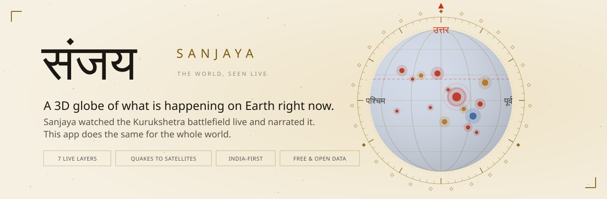
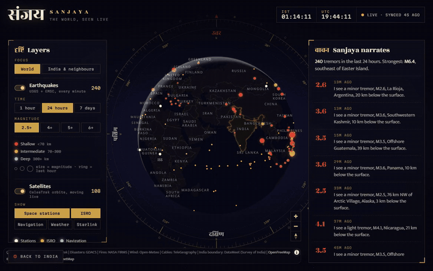
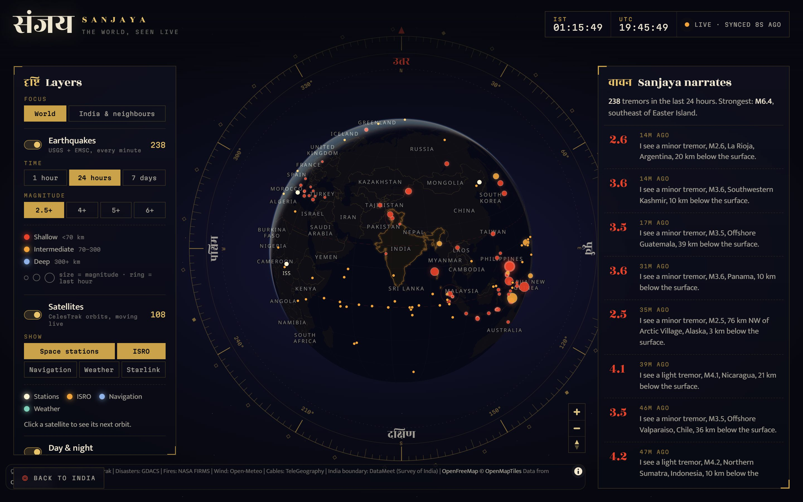
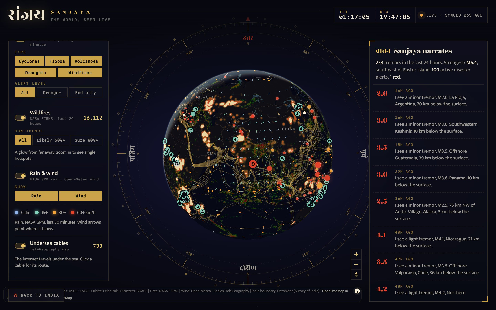
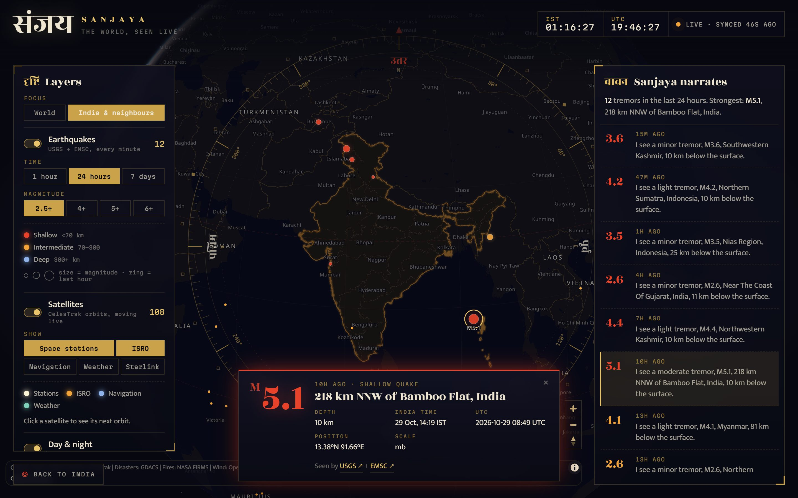
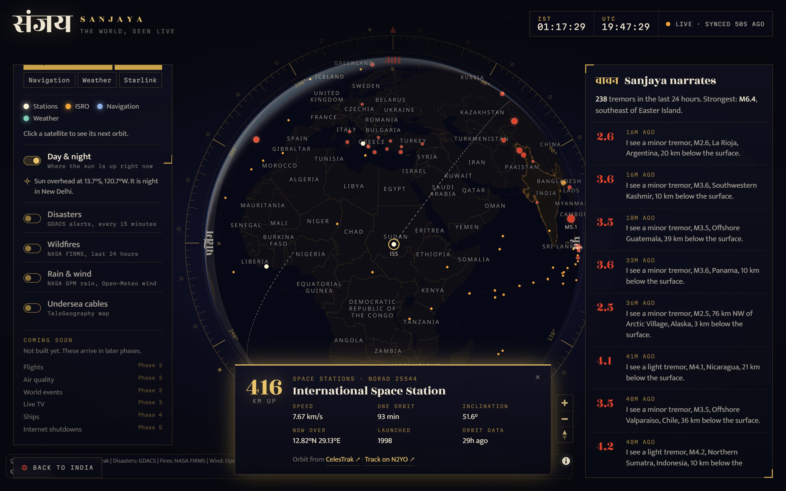
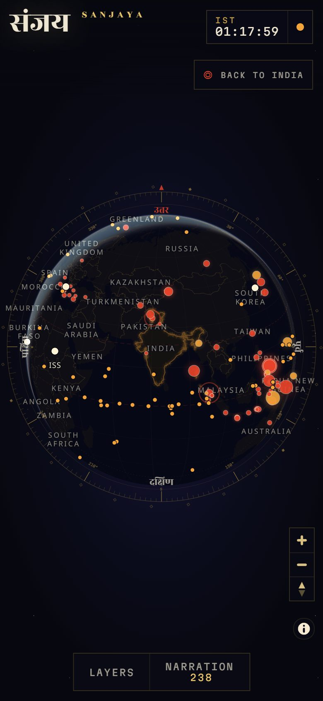
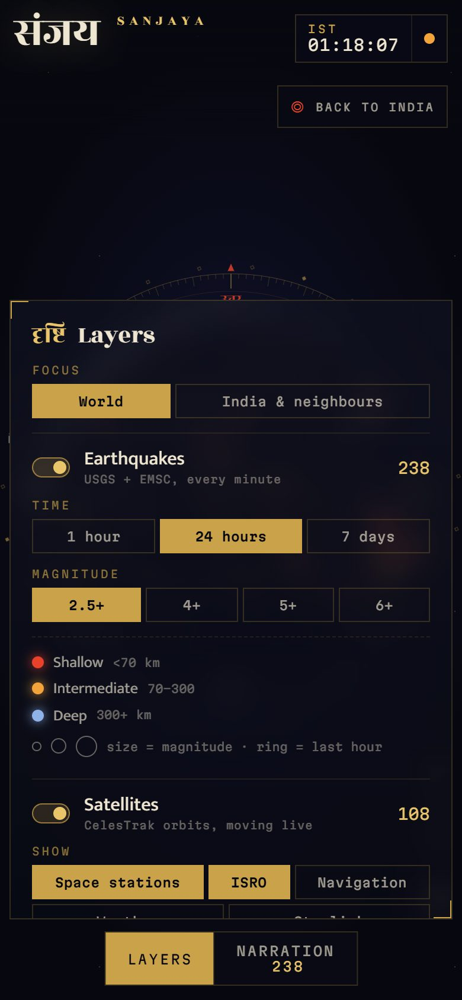
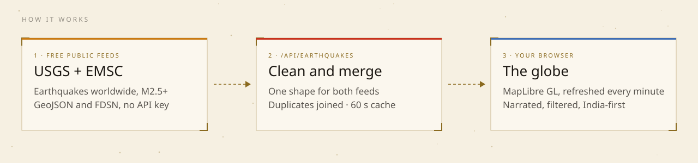

<picture>
  <source media="(prefers-color-scheme: dark)" srcset="docs/readme/banner-dark.svg">
  
</picture>

<table align="center">
  <tr>
    <td align="center">
      <h2>संजय · Sanjaya</h2>
      <b>The one who saw the whole war, live, and told the king what was happening.</b><br><br>
      In the Mahabharata, the sage Vyasa gave Sanjaya <b><i>divya drishti</i></b>, divine sight.<br>
      From the palace in Hastinapura he watched the Kurukshetra battlefield as it happened<br>
      and narrated every moment to the blind king Dhritarashtra.<br><br>
      <b>This app is that sight for today's world.</b><br>
      It watches free, public data feeds and tells you what is happening on Earth right now,<br>
      on one 3D globe, India-first. <a href="#why-the-name-sanjaya">Read more about the name ↓</a>
    </td>
  </tr>
</table>

<p align="center">
  <a href="https://sanjaya-live.vercel.app"><b>Open the live globe →</b></a> ·
  <a href="#why-the-name-sanjaya">Why the name</a> ·
  <a href="#what-you-can-see">What you can see</a> ·
  <a href="#how-it-works">How it works</a> ·
  <a href="#run-it-locally">Run locally</a> ·
  <a href="#roadmap">Roadmap</a>
</p>

<p align="center">
  
  
  
  
  
  
  
</p>

## Why the name "Sanjaya"?

Before the Kurukshetra war began, the sage Vyasa offered the blind king Dhritarashtra the power to see the battle. The king did not want to watch his own family fall, so Vyasa gave that gift, **divya drishti** (divine sight), to Sanjaya, the king's charioteer and advisor. From the palace in Hastinapura, far from the battlefield, Sanjaya saw everything as it happened and described it to the king. The Bhagavad Gita reaches us through his narration: it opens with the king asking Sanjaya what is happening at Kurukshetra.

That is exactly what this app tries to do:

| Sanjaya in the Mahabharata | Sanjaya the app |
|---|---|
| Watched a distant battlefield from the palace | Shows the whole planet from your screen |
| Saw events as they happened | Live feeds, refreshed every minute |
| Narrated to a king who could not see | The **Sanjaya narrates** feed describes each event in plain sentences |
| Reported what he saw, without taking sides | Shows public data as it is, with a link to every source |

The name also fits an **India-first** project, and it carries through the design: the Devanagari wordmark संजय, **दृष्टि** (*drishti*, sight) on the layers panel, **वाचन** (*vachan*, narration) on the live feed, and the Sanskrit directions उत्तर, पूर्व, दक्षिण, पश्चिम on the brass dial. In Sanskrit, *sañjaya* also means "complete victory".

<p align="center">
  <picture>
    <source type="image/webp" srcset="docs/readme/demo.webp">
    
  </picture>
  <br><sub>25 s of the app. <a href="docs/readme/demo.mp4">Watch the MP4</a> for full quality.</sub>
</p>

## What you can see

Seven live layers, each with its own switch and filters. Earthquakes, satellites and day & night are on when you open it.

| Layer | What it shows | Source | Fresh |
|---|---|---|---|
| **Earthquakes** | Every quake M2.5+, sized by magnitude, coloured by depth; the last hour pulses | USGS + EMSC, merged | 1 min |
| **Satellites** | Space stations, **88 ISRO satellites**, navigation, weather and Starlink, moving live; click one for its next orbit | CelesTrak | positions every second |
| **Day & night** | The night side of Earth, the line where the sun is setting, and the point where it is overhead | Worked out in your browser | 1 min |
| **Disasters** | Cyclones, floods, volcanoes, droughts and large wildfires, with green / orange / red alert levels | GDACS (UN + European Commission) | 15 min |
| **Wildfires** | Every fire hotspot seen from orbit in the last 24 hours: a glow far out, single fires up close | NASA FIRMS (MODIS) | 1 hour |
| **Rain & wind** | Rain from NASA's GPM satellites, and wind arrows coloured by speed, denser over India | NASA GIBS, Open-Meteo | 30 min / 3 hours |
| **Undersea cables** | All 700+ internet cables under the sea; click one for its length, landings and owners | TeleGeography | daily |

<table>
  <tr>
    <td width="50%"></td>
    <td width="50%"></td>
  </tr>
  <tr>
    <td><b>Earthquakes and satellites.</b> India's geostationary satellites (GSAT, INSAT, NavIC) form a saffron line along the equator.</td>
    <td><b>Everything on.</b> Disaster alerts, fire glow, rain, wind and the cables that carry the internet.</td>
  </tr>
  <tr>
    <td></td>
    <td></td>
  </tr>
  <tr>
    <td><b>India & neighbours.</b> India is drawn with its official boundary and state lines. One switch focuses every layer on South Asia; click any quake for depth, India time, felt reports and its sources.</td>
    <td><b>Follow the ISS.</b> Altitude, speed and position update every second; the dashed line is where it goes next.</td>
  </tr>
</table>

- **Sanjaya narrates.** A live feed of earthquakes and disaster alerts in plain sentences: *"I see a moderate tremor, M5.1, 218 km NNW of Bamboo Flat, India, 10 km below the surface."* Click a line and the globe flies there.
- **Is it night in Delhi?** The day & night layer tells you where the sun is overhead and whether it is day or night in New Delhi.
- **Always current, never blank.** Each feed refreshes on its own schedule. If one fails, you keep its last good data; if CelesTrak is busy, orbits come from a copy saved at build time, and every satellite card shows how old its orbit is.
- **A brass sighting dial** after the Jantar Mantar instruments frames the globe and turns when you rotate the map. The Tropic of Cancer, which runs through India, is marked.

<table>
  <tr>
    <td width="33%"></td>
    <td width="33%"></td>
    <td width="34%" valign="top">
      <b>On your phone</b><br><br>
      Open <a href="https://sanjaya-live.vercel.app">sanjaya-live.vercel.app</a>. Pinch and drag the globe, tap anything for details, and open <b>Layers</b> or <b>Narration</b> from the bottom bar.<br><br>
      No sign-in, no tracking, no API keys.
    </td>
  </tr>
</table>

## How it works

<picture>
  <source media="(prefers-color-scheme: dark)" srcset="docs/readme/how-it-works-dark.svg">
  
</picture>

1. **One small API route per feed** (`/api/earthquakes`, `/api/satellites`, `/api/disasters`, `/api/fires`, `/api/wind`, `/api/cables`) fetches the source, turns it into a compact shape, and caches it in memory and on the CDN, from 1 minute (earthquakes) to 24 hours (cables). Upstream calls retry once and fall back to the last good copy.
2. **The browser** only asks for a feed while its layer is on. Satellite positions are calculated on your device with SGP4, a few hundred per frame, so even Starlink's thousands never freeze the page.
3. **No database, no keys.** Everything comes from free, open feeds.

<details>
<summary><b>Project layout</b></summary>

| Path | What it does |
|---|---|
| `src/lib/quakes.ts` | Normalizes USGS and EMSC, merges duplicates, filters, writes the narration |
| `src/lib/satellites.ts` | Satellite groups, ISRO name matching, CelesTrak download, SGP4 positions and ground tracks |
| `src/lib/hazards.ts` | Parses GDACS disasters, the FIRMS fire CSV and the Open-Meteo wind grid |
| `src/lib/sun.ts` | Where the sun is overhead, and the night-side polygon |
| `src/lib/server/upstream.ts` | Shared fetch with timeout and retry, in-memory cache, CDN headers |
| `src/app/api/*/route.ts` | One route per feed |
| `src/components/Globe.tsx` | The MapLibre globe: data, visibility, clicks, satellite animation, fly-to |
| `src/components/mapLayers.ts` | Every map layer's style, in stacking order |
| `src/components/mapStyle.ts` | The night-observatory basemap, graticule, equator and Tropic of Cancer |
| `src/components/Panels.tsx` / `Cards.tsx` | Layer panel, narration feed, and the detail card for each kind of thing |
| `src/components/Observatory.tsx` | Page shell: feeds, filters, selection, phone bottom sheets |
| `public/geo/` | India's official boundary, state lines and state names (simplified from DataMeet with mapshaper) |
| `scripts/snapshot-orbits.ts` | Saves backup orbits to `public/orbits/` before each build |
| `scripts/copy-maplibre-worker.mjs` | Copies MapLibre 6's worker into `public/` (Turbopack doesn't bundle it) |
| `docs/readme/` | README media and the scripts that make it |

Tests (`npm test`) cover the feed parsers, duplicate merging, sun position, ISS orbit math, ground tracks and ISRO name matching.

</details>

<details>
<summary><b>Design notes</b></summary>

- **Palette:** ink-indigo night, brass instrument lines, sindoor red, saffron, nila blue and jade.
- **Type:** Rozha One for Devanagari and Latin display, Mukta (an Indian Type Foundry family) for reading, Martian Mono for numbers.
- **India's boundary:** India is drawn with its official boundary as per the Survey of India, including all of Jammu & Kashmir, Ladakh and Arunachal Pradesh, with official state lines. Other countries' lines inside that outline are hidden, and no disputed line is drawn anywhere.
- **Motion:** the globe spins in to India, new events ink into the feed, recent quakes pulse, satellites move. All of it calms down with *reduce motion*.

</details>

## Run it locally

```bash
git clone https://github.com/jagdish3135/sanjaya.git
cd sanjaya
npm install
npm run dev
```

Open http://127.0.0.1:3110. No API keys are needed. Node 24 is required (the orbit backup script runs TypeScript directly).

| Script | Does |
|---|---|
| `npm run dev` | Dev server on port 3110 |
| `npm run dev:lan` | Dev server reachable from phones on the same Wi-Fi |
| `npm run build` / `npm start` | Production build and server |
| `npm test` | Unit tests (Vitest) |
| `npm run typecheck` / `npm run lint` | TypeScript and ESLint |
| `npm run orbits` | Refresh the backup orbits in `public/orbits/` |
| `node docs/readme/make-svgs.mjs` | Rebuild the README banner and diagram |
| `node docs/readme/capture.mjs` | Re-capture README screenshots and the demo video (needs the dev server and ffmpeg) |

Deploys to Vercel as a standard Next.js app.

## Roadmap

| Phase | Layers |
|---|---|
| ✅ 1 | Globe, layer panel, **earthquakes** (USGS + EMSC) |
| ✅ 2 | **Satellites** (CelesTrak), **day & night**, **disasters** (GDACS), **wildfires** (NASA FIRMS), **rain & wind** (NASA GIBS, Open-Meteo), **undersea cables** |
| 3 | Flights (adsb.lol), air quality (WAQI), world events (GDELT), live TV, traffic cameras |
| 4 | Ships in the Indian Ocean (aisstream.io) |
| 5 | Internet shutdowns (IODA), cyber threats |
| 6 | Ask in plain English: an AI assistant that flies the map and switches layers |
| 7 | Polish and launch |

The full plan and the list of free APIs is in [PROJECT.md](PROJECT.md).

## Data and credits

- **Earthquakes:** [USGS Earthquake Hazards Program](https://earthquake.usgs.gov/earthquakes/feed/) and [EMSC SeismicPortal](https://www.seismicportal.eu/)
- **Satellite orbits:** [CelesTrak](https://celestrak.org/), positions with [satellite.js](https://github.com/shashwatak/satellite-js)
- **Disasters:** [GDACS](https://www.gdacs.org/), the Global Disaster Alert and Coordination System
- **Wildfires:** [NASA FIRMS](https://firms.modaps.eosdis.nasa.gov/), MODIS active fire data
- **Rain:** [NASA GIBS](https://www.earthdata.nasa.gov/engage/open-data-services-software/earthdata-developer-portal/gibs-api), GPM IMERG precipitation rate
- **Wind:** [Open-Meteo](https://open-meteo.com/) (CC BY 4.0)
- **Undersea cables:** © [TeleGeography](https://www.submarinecablemap.com/) (CC BY-NC-SA 4.0)
- **India's boundary and states:** [India boundaries](https://github.com/datameet/maps/blob/master/Country/india-composite.geojson) and [state boundaries](https://github.com/datameet/maps/tree/master/States) by the [DataMeet India community](http://datameet.org/) (CC0 and CC BY 4.0), as per the Survey of India
- **Basemap:** [OpenFreeMap](https://openfreemap.org/), © [OpenMapTiles](https://openmaptiles.org/), data © [OpenStreetMap](https://www.openstreetmap.org/copyright) contributors

Some sources allow non-commercial use only, so Sanjaya stays free.

> Data comes from public sources and can be delayed, incomplete or wrong. Do not use Sanjaya for navigation, emergencies or official decisions. For earthquake, cyclone and tsunami warnings in India, follow IMD, NCS, INCOIS and NDMA.
