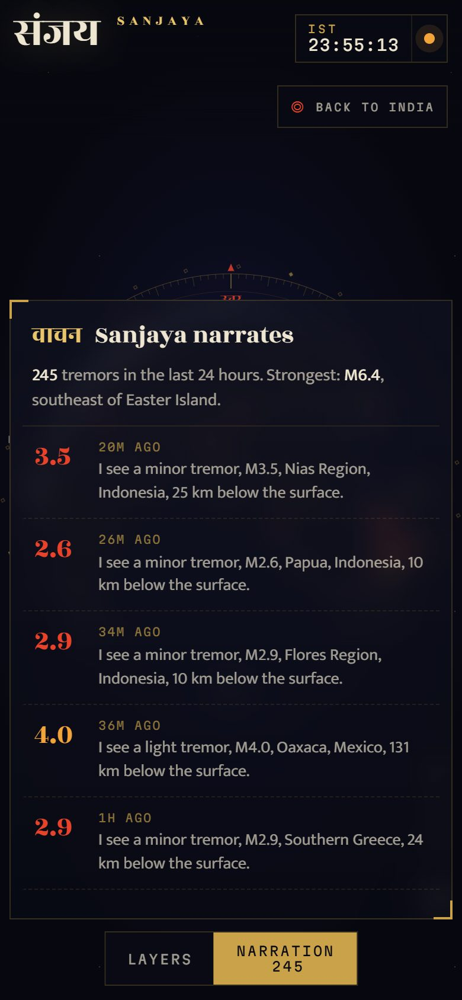

<picture>
  <source media="(prefers-color-scheme: dark)" srcset="docs/readme/banner-dark.svg">
  
</picture>

<p align="center">
  <a href="https://sanjaya-live.vercel.app"><b>Open the live globe →</b></a> ·
  <a href="#what-you-can-do">What you can do</a> ·
  <a href="#how-it-works">How it works</a> ·
  <a href="#run-it-locally">Run locally</a> ·
  <a href="#roadmap">Roadmap</a>
</p>

<p align="center">
  
  
  
  
  
  
  
</p>

In the Mahabharata, **Sanjaya** (संजय) was given divine sight to watch the whole Kurukshetra battlefield live and narrate it to the blind king. **This app does the same for today's world.** It watches free, public data feeds and shows what is happening on Earth right now on one 3D globe, India-first, and narrates it in plain sentences.

Phase 1 ships the foundation and the first live layer: **earthquakes**, worldwide, from USGS and EMSC.

<p align="center">
  <picture>
    <source type="image/webp" srcset="docs/readme/demo.webp">
    
  </picture>
  <br><sub>21 s of the live site. <a href="docs/readme/demo.mp4">Watch the MP4</a> for full quality.</sub>
</p>

## What you can do

<table>
  <tr>
    <td width="50%"></td>
    <td width="50%"></td>
  </tr>
  <tr>
    <td><b>See every quake on Earth.</b> Dots are sized by magnitude and coloured by depth: <b>red</b> shallow, <b>saffron</b> intermediate, <b>blue</b> deep. Quakes from the last hour pulse.</td>
    <td><b>Zoom into India and its neighbours.</b> Click any quake for magnitude, depth, India time and UTC, position, felt reports, impact alert and links to each source.</td>
  </tr>
</table>

- **Sanjaya narrates.** A live feed tells you what it sees: *"I see a moderate tremor, M5.1, 218 km NNW of Bamboo Flat, India, 10 km below the surface."* Click a line and the globe flies there.
- **Filter fast.** World or India & neighbours, the last hour, 24 hours or 7 days, magnitude 2.5+, 4+, 5+ or 6+.
- **Two sources, one dot.** When USGS and EMSC report the same quake, it is merged into one and credited to both.
- **Always current.** Data refreshes every minute; the status light shows when it last synced. If a feed fails, you keep the last good data.
- **A brass sighting dial** after the Jantar Mantar instruments frames the globe, with directions in Sanskrit (उत्तर पूर्व दक्षिण पश्चिम). It turns when you rotate the map. The Tropic of Cancer, which runs through India, is marked.
- **Works on phones.** Panels become bottom sheets; tap **Layers** or **Narration**.

<table>
  <tr>
    <td width="33%"></td>
    <td width="33%"></td>
    <td width="34%" valign="top">
      <b>On your phone</b><br><br>
      Open <a href="https://sanjaya-live.vercel.app">sanjaya-live.vercel.app</a>. Pinch and drag the globe, tap a dot for details, and open the narration from the bottom bar.<br><br>
      No sign-in, no tracking, no API keys.
    </td>
  </tr>
</table>

## How it works

<picture>
  <source media="(prefers-color-scheme: dark)" srcset="docs/readme/how-it-works-dark.svg">
  
</picture>

1. **`/api/earthquakes`** fetches the USGS GeoJSON feed and the EMSC FDSN feed in parallel, turns both into one shape, joins duplicates (within 90 s, 150 km and 1 magnitude unit) and caches the result for 60 s, so many visitors cost one upstream call a minute.
2. **The browser** polls that route every minute and draws the quakes on a MapLibre GL globe with an OpenFreeMap basemap restyled as a night observatory.
3. **No database, no keys.** Everything comes from free, open feeds.

<details>
<summary><b>Project layout</b></summary>

| Path | What it does |
|---|---|
| `src/lib/quakes.ts` | Normalizes USGS and EMSC, merges duplicates, filters, writes the narration (tested in `quakes.test.ts`) |
| `src/app/api/earthquakes/route.ts` | The API route: parallel fetch, timeouts, in-memory cache, CDN cache headers, stale data on failure |
| `src/components/Globe.tsx` | MapLibre globe, quake layers, pulse animation, fly-to |
| `src/components/mapStyle.ts` | The night-observatory basemap, graticule, equator and Tropic of Cancer |
| `src/components/Dial.tsx` | The brass sighting dial |
| `src/components/Panels.tsx` | Masthead and clocks, layer panel, narration feed, details card |
| `src/components/Observatory.tsx` | Page shell: state, polling, filters, phone bottom sheets |
| `scripts/copy-maplibre-worker.mjs` | Copies MapLibre 6's worker into `public/` (Turbopack doesn't bundle it) |
| `docs/readme/` | README media and the scripts that make it |

</details>

<details>
<summary><b>Design notes</b></summary>

- **Palette:** ink-indigo night, brass instrument lines, sindoor red, saffron and nila blue for quake depth.
- **Type:** Rozha One for Devanagari and Latin display, Mukta (an Indian Type Foundry family) for reading, Martian Mono for numbers.
- **Borders:** disputed boundary lines are not drawn, so no de facto line runs through a claimed region.
- **Motion:** the globe spins in to India, new quakes ink into the feed, recent quakes pulse. All of it turns off with *reduce motion*.

</details>

## Run it locally

```bash
git clone https://github.com/jagdish3135/sanjaya.git
cd sanjaya
npm install
npm run dev
```

Open http://127.0.0.1:3110. No API keys are needed.

| Script | Does |
|---|---|
| `npm run dev` | Dev server on port 3110 |
| `npm run dev:lan` | Dev server reachable from phones on the same Wi-Fi |
| `npm run build` / `npm start` | Production build and server |
| `npm test` | Unit tests (Vitest) |
| `npm run typecheck` / `npm run lint` | TypeScript and ESLint |
| `node docs/readme/make-svgs.mjs` | Rebuild the README banner and diagram |
| `node docs/readme/capture.mjs` | Re-capture README screenshots and the demo video (needs ffmpeg) |

Deploys to Vercel as a standard Next.js app.

## Roadmap

| Phase | Layers |
|---|---|
| ✅ 1 | Globe, layer panel, **earthquakes** (USGS + EMSC) |
| 2 | Satellites (CelesTrak), day and night line, disasters (GDACS), wildfires (NASA FIRMS), wind and rain (Open-Meteo), undersea cables |
| 3 | Flights (adsb.lol), air quality (WAQI), world events (GDELT), live TV, traffic cameras |
| 4 | Ships in the Indian Ocean (aisstream.io) |
| 5 | Internet shutdowns (IODA), cyber threats |
| 6 | Ask in plain English: an AI assistant that flies the map and switches layers |
| 7 | Polish and launch |

The full plan and the list of free APIs is in [PROJECT.md](PROJECT.md).

## Data and credits

Earthquakes: [USGS Earthquake Hazards Program](https://earthquake.usgs.gov/earthquakes/feed/) and [EMSC SeismicPortal](https://www.seismicportal.eu/). Basemap: [OpenFreeMap](https://openfreemap.org/), © [OpenMapTiles](https://openmaptiles.org/), data © [OpenStreetMap](https://www.openstreetmap.org/copyright) contributors.

> Data comes from public sources and can be delayed, incomplete or wrong. Do not use Sanjaya for navigation, emergencies or official decisions. For earthquake and tsunami warnings in India, follow NCS, INCOIS and NDMA.
